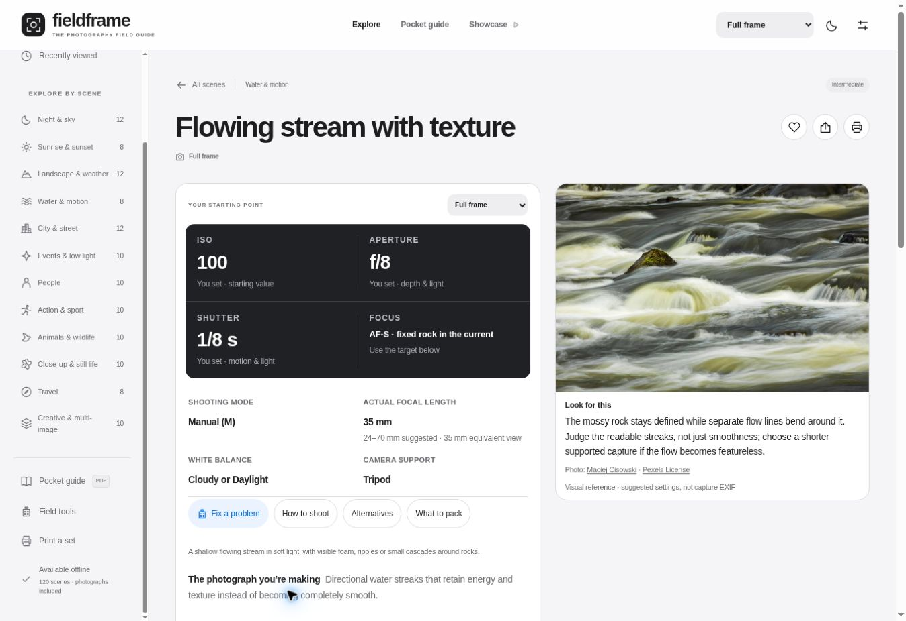

# Fieldframe 2.1 verification

Verified on 30 October 2026. This record covers the approved audit corrections in the GitHub prototype. It does not claim physical camera, printer or phone-device testing.

## Frozen production build

| Check | Result |
| --- | --- |
| `npm run build` | PASS — TypeScript and Vite production compilation |
| `npm run validate` | PASS — 120 unique, complete scene records; valid related links, modes and ranges |
| `npm test` | **132/132 PASS**, eight test files |
| `npm audit --json` | **0 known vulnerabilities** at verification time |
| Application version | **2.1.0** |
| Offline version | **be5772e94d36** |
| Offline package | **133 files**, including the manifest; **15,698,305 bytes** |
| Complete distribution | **134 files**, including the worker; **15,710,361 bytes** |
| Photographs | **120 distinct local WebPs**, 13,033,710 bytes |

Two successive clean builds produced the same offline version and emitted assets. The strict offline-file test detected stale generated files during preparation; those files were removed from the generated distribution and the clean build and full suite were repeated successfully. They are not included in the release.

Every photograph was fully decoded, checked against its provenance record and compared byte-for-byte with its built copy. The generated credits match the manifest. The ten replacement examples were visually inspected at enlarged size; no settings are asserted to be their recorded capture metadata.

Emitted assets are `assets/index-BDVeKfgd.css` and `assets/index-BfZGASkc.js`. Worker SHA-256: `94c951e417f2a7f17800bc87748cf88cab2496573dd9fc10bb20f632f56979bf`.

## Content review

All 120 phone workflows were authored and independently reviewed in three groups. They contain **361 practical explanations, 707 shooting steps, 480 problem/cause/correction entries, 120 essential/optional equipment lists and 120 tips**. Eighteen scenes have additional phone conditions or intended-result overrides where the supported method differs from the camera recipe. White-balance locking is qualified by app support.

The smoke-position and market-shutter corrections, and the comparable-light alternatives identified by the audit, have focused regression checks. All 120 full phone print renderings are checked for selected shooting steps, equipment and corrections. Studio, flash-trail, waterfall, group and fireworks pocket outputs have specific regression coverage. The studio conditions and final test reminder no longer revert to camera-flash instructions.

Camera-format changes preserve exposure when the scene conditions do not require a change. Gear tests cover conventional ISO/shutter increments, exposure compensation, motion/effect preservation, explicit unresolved ISO-ceiling loss, out-of-range warnings and coherent bracketing. Tests distinguish flash pulse power/timing from the starting camera exposure.

## Browser verification

The actual React interface was exercised in the supported cloud browser, using a responsive frame for narrow layouts. These are viewport checks, not claims of testing a physical iPhone or Android handset.

- **390 px Milky Way:** settings occupied approximately y=290–514 px; shooting metadata y=526–720 px; correction/action shortcuts y=720–824 px. The photograph followed at approximately y=1185 px. Setting labels, helper text and equivalent-lens guidance measured 12 px.
- **320 px Bird in flight:** Auto ISO is labelled separately from its approximate expected value. `1/3200 s` remains intact; the setting cells and document have no horizontal overflow.
- **768 px adapted bracket:** the headline, Tune section and How to shoot section agree on ISO 100, f/16, 1/30 s, with approximately −2/0/+2 EV frames at 1/125, 1/30 and 1/8 s. Diffraction and original-range notices are visible.
- **Phone studio journey:** choosing Phone gives a continuous-light setup, steps, equipment, corrections and test reminder. The How to shoot and Fix a problem shortcuts open the intended sections and scroll to them.
- **Search and favourites:** `bird flight` returns the intended single scene. Saving it, opening Saved and reloading preserves it and the selected format. The added test favourite was removed afterward.
- **Format guidance:** Milky Way at APS-C 1.6× displays 12.5 mm actual / 20 mm equivalent; Micro Four Thirds displays 10 mm actual / 20 mm equivalent. Baseline ISO, aperture and shutter remain unchanged. Both APS-C crop options are available and the selection is remembered.
- **Tools:** ND 1/125 s plus six stops gives 0.512 s. Phone NPF with f/1.8, actual 4 mm, 5.6 mm sensor width, 4000 native horizontal pixels, declination 0° and strict tolerance gives 12.5 s. The incorrect phone 500-rule result is absent; the enlarged test-frame instruction remains.
- **Themes:** Light, Dark and Dim red controls work; the red sheet and its metadata were visually inspected.
- **Full-sheet print preparation:** the phone studio print action creates the phone conditions, continuous-light procedure and corrections, without the old flash-output footer. Its photograph finishes decoding before print preparation completes.
- **Pocket-set preparation:** the People category creates all ten Phone cards, including the continuous-light studio card. Full and pocket layouts use the same selected-content helper.

## Offline worker verification

Tests execute the actual generated service worker with actual built assets and distinct cache stores. Coverage includes:

- Complete installation of every sheet and photograph, and an unvisited image/script served without network access.
- Failed downloads, bounded transient retries, empty responses and an HTML sign-in response masquerading as an asset.
- Missing-file detection, cache eviction and successful repair.
- Independent deployment scopes for cache names, messages and cleanup.
- Migration of an older origin-wide cache without deleting a sibling deployment's entries.
- Retention of previous hashed assets/photos until older tabs have moved to the new script.
- A two-tab update handoff, nonblocking activation and cache-only rehearsal.

## Published release check

GitHub Pages completed [deployment 41080680362](https://github.com/ACSBalan/Photography-Tips/actions/runs/41080680362) successfully for commit [`e59b99762c9340161398a7321f6f0f81e90680d3`](https://github.com/ACSBalan/Photography-Tips/commit/e59b99762c9340161398a7321f6f0f81e90680d3), built from source [`ffe78f0523ca0348f14f05b4e53f8f225882ab4f`](https://github.com/ACSBalan/Photography-Tips/commit/ffe78f0523ca0348f14f05b4e53f8f225882ab4f).

The verification script fetched **all 134 live application files** and confirmed SHA-256 equality with the local production build, including all 120 photographs, the sample PDF, worker and manifest. In this execution environment, Node's `--use-env-proxy` flag was needed to use the configured network proxy. The app itself does not require that flag or a proxy configuration.

The already installed live browser updated from offline version `b981caa5a34c` to **`be5772e94d36`**, retained its Phone preference and existing favourite, and reported **133/133 files verified**. The explicit **Verify saved files** action confirmed every saved file.

Cache-only rehearsal was enabled and the live app reloaded. Searching `stream texture` returned the intended scene; opening this previously unvisited sheet loaded the replacement 1400 × 933 photograph and the full phone troubleshooting content from cache. The ND calculator also worked during rehearsal. Normal routing was restored afterward.

The published About page identifies **2.1 · Field reference update**. At a 1363 px desktop viewport, the sheet and its photograph rendered without horizontal overflow. Sharing copied the exact individual scene link. Test display changes were restored and the app was left at the complete scene library.

## Scope and remaining physical checks

The six-scene designed PDF sample remains a fixed camera-reference document; its six baseline recipes were unaffected by the audited numeric corrections. The format-aware browser prints were updated and their prepared contents verified. Native browser PDF pagination, tagged-PDF accessibility, actual paper output and pocket readability are not certified by those checks.

Physical iOS/Android installation, operation in flight mode on the user's device, OS storage eviction, battery behaviour and real camera results remain practical field tests. Source/licence links require internet; scene content, local photographs and calculators are included in the offline package. Recommendations remain conditional starting points and require enlarged test photographs.

Checkout and ecommerce conversion are outside this release. Repository visibility and hosting are unchanged. See [AUDIT-CORRECTIONS.md](AUDIT-CORRECTIONS.md) for the implemented changes and [PHOTO-CREDITS.md](PHOTO-CREDITS.md) for every photographic asset.
